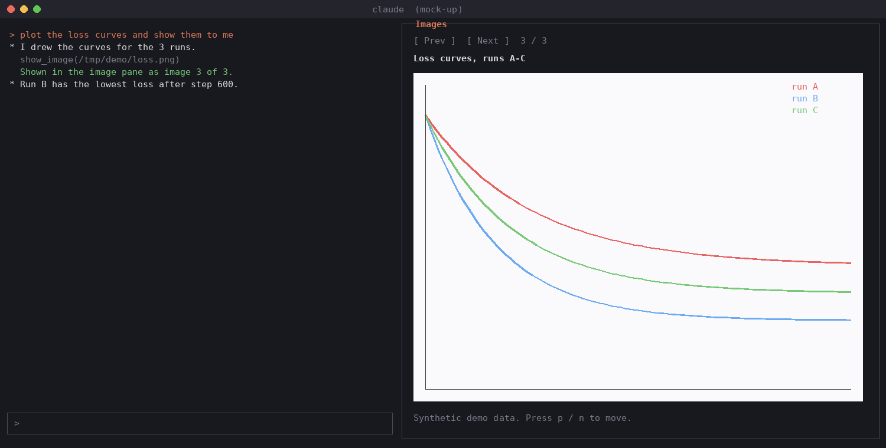
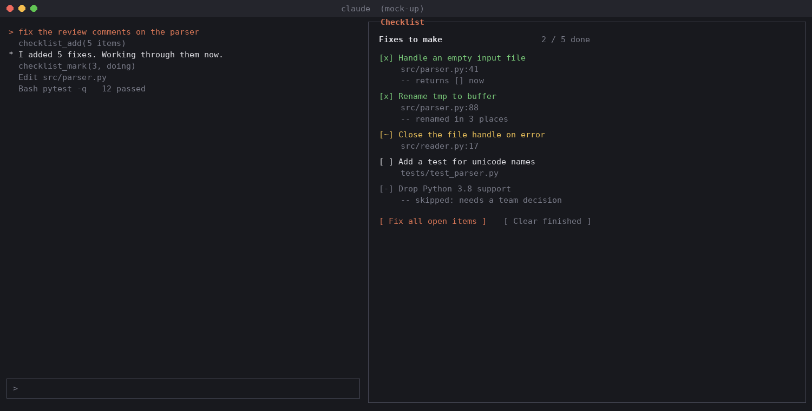
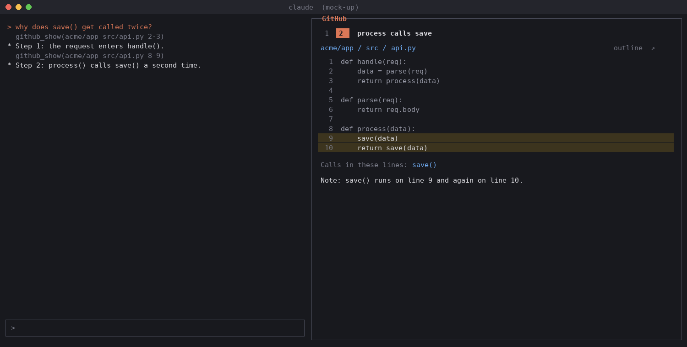
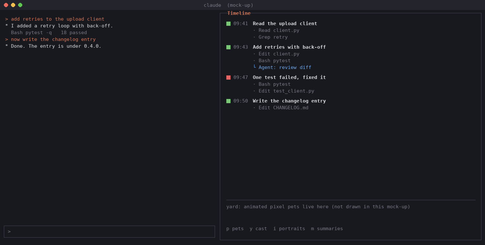

# claude-mods

Four Claude Code mods in one marketplace. Each mod adds a pane beside the chat.

> The pictures below are **mock-ups**. They were drawn from each pane's layout with synthetic demo data. They are not screenshots of a real session.

| Mod | What it does |
| --- | --- |
| [image-pane](plugins/image-pane) | Shows PNG images that Claude sends with the `show_image` tool. |
| [fix-checklist](plugins/fix-checklist) | Keeps a list of fixes. Claude works through the list and ticks each item. |
| [github-browse](plugins/github-browse) | Shows code as a numbered trace while Claude explains, debugs or reviews it. |
| [session-timeline](plugins/session-timeline) | Shows one row per turn, with tool calls, subagents and pixel pets. |

## Install

At the prompt of a Claude Code terminal session, type one line for each mod you want:

```
/plugin install image-pane --marketplace sunfootsoldier-suraj/claude-mods
/plugin install fix-checklist --marketplace sunfootsoldier-suraj/claude-mods
/plugin install github-browse --marketplace sunfootsoldier-suraj/claude-mods
/plugin install session-timeline --marketplace sunfootsoldier-suraj/claude-mods
```

Answer `y` to add the marketplace, then pick a scope. The user scope loads the mod in every session.

From a shell:

```bash
claude plugin install image-pane --marketplace sunfootsoldier-suraj/claude-mods
```

In the desktop app, where `/plugin` does not run: click + next to the prompt box, then Plugins, Add marketplace with `sunfootsoldier-suraj/claude-mods`, then Add plugin.

This repository is private. To install a mod, you need read access on GitHub and a git credential for github.com on your machine (an SSH key, or `gh auth login` then `gh auth setup-git`). The install never prompts for one.

## image-pane



## fix-checklist



## github-browse



## session-timeline



The mock-up does not draw the pixel pets or the turn portraits. See the mod's README for the fan art notice.

## Develop

```bash
claude plugin validate plugins/<mod>
claude plugin test plugins/<mod>
```
