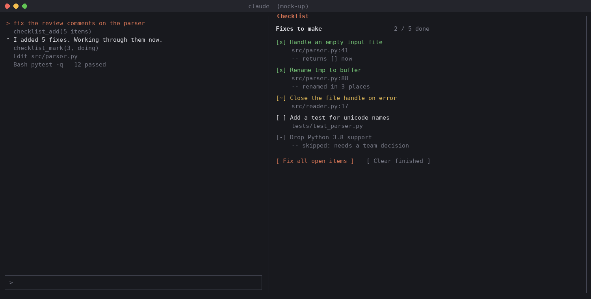

# fix-checklist

A Claude Code mod that keeps a checklist pane beside the chat. You give Claude a list of fixes, or Claude puts its own findings on the list, and Claude then works through every item in one go. The pane ticks each item as Claude finishes it.

- `/checklist` opens the pane.
- `/checklist add <fix>` adds one item. Repeat for each fix.
- `/checklist go`, or the **Fix all open items** button, asks Claude to work through every open item in order.
- `/checklist clear` empties the list. **Clear finished** removes done and skipped items.

Claude drives the pane with two tools: `checklist_add` (title, replace, items with text, file and line) and `checklist_mark` (id, status `todo|doing|done|skipped`, note).

## Install

At the prompt of a Claude Code terminal session:

```
/plugin install fix-checklist --marketplace sunfootsoldier-suraj/claude-mods
```

Answer `y` to add the marketplace, then pick a scope.


