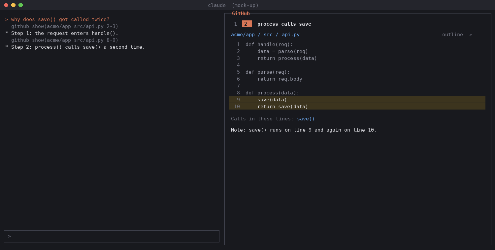

# github-browse

A Claude Code mod that adds a minimal, GitHub-style code browser pane beside the chat. When you ask Claude to debug, explain or review code, it walks you through it as a numbered trace: each step jumps the pane to the file and highlights the lines Claude is talking about.

- **Trace steps**: `1 2 3 …` across the top; click any step, or use ← → (`p` / `n` while the pane is focused).
- **Code view**: line numbers, syntax colors, highlighted lines with faded context, long lines wrapped. Follows light and dark mode on the desktop app.
- **Jump to definition**: functions called in the highlighted lines are listed under the code; click one to open its definition (same file first, then `git grep` locally or GitHub code search for a repo).
- **Browse**: click a folder in the path to list it, `outline` for the file's functions, `more` for wider context, ↗ to open on GitHub.

Claude drives it with the `github_show` tool (`repo`, `path`, `ref`, `start_line`, `end_line`, `title`, `note`, `new_trace`). `/github-browse` opens the pane yourself.

## Requirements

- Claude Code with function-hook mods (desktop app or terminal).
- For GitHub repositories: the [GitHub CLI](https://cli.github.com/) installed and signed in (`gh auth login`). Local files need nothing extra.

## Install

At the prompt of a terminal Claude Code session:

```
/plugin install github-browse --marketplace sunfootsoldier-suraj/claude-mods
```

From a shell:

```bash
claude plugin install github-browse --marketplace sunfootsoldier-suraj/claude-mods
```

Answer `y` to add the marketplace, then choose a scope (user scope makes it load in every session).

In the desktop app, where `/plugin` does not run: click + next to the prompt box, then Plugins, Add marketplace with `sunfootsoldier-suraj/claude-mods`, then Add plugin.

This repository is private: installing it needs read access on GitHub and a git credential for github.com on that machine (an SSH key, or `gh auth login` then `gh auth setup-git`). The install never prompts for one.

## Development

```bash
claude plugin validate .
claude plugin test .
```



The picture is a mock-up drawn with synthetic demo data.
