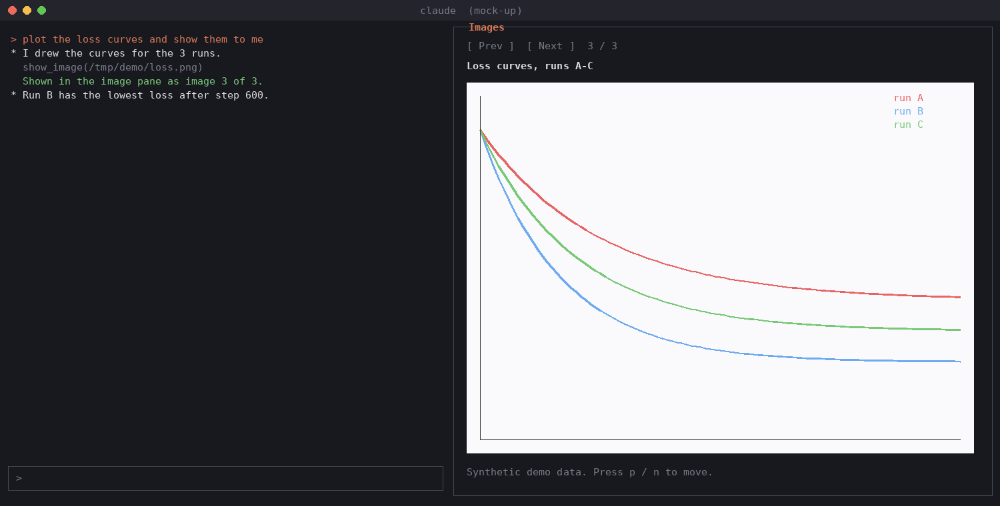

# image-pane

A Claude Code mod that shows PNG images in a side pane beside the chat.

- Claude sends an image with the `show_image` tool (`mcp__image-pane__show_image`). Give an absolute path to a PNG of 2 MiB or smaller.
- Type `/images` to open the pane.
- Press `p` and `n` in the pane to move to the previous and next image.
- The pane draws pixels in kitty, Ghostty, or iTerm2 3.5 and later. Other terminals show the title as text.

## Install

At the prompt of a Claude Code terminal session:

```
/plugin install image-pane --marketplace sunfootsoldier-suraj/claude-mods
```

Answer `y` to add the marketplace, then pick a scope.


