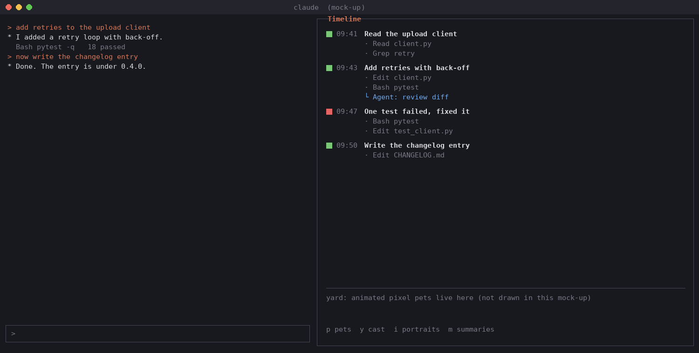

# session-timeline

A Claude Code mod. It adds a timeline pane to the side of the session, a status band above the prompt, and an animated pixel yard.

- **Timeline:** one row per turn, with a few-word summary from a small model, the tool calls under it, and a lane for each subagent. The pane scrolls as far as the session goes.
- **Turn portraits:** a small face beside each turn shows how the turn went. Zenitsu, Tanjiro and Rengoku mark turns that worked, by length. Rui, Akaza and Muzan mark failed calls, by count.
- **Yard:** a chibi head floats under the timeline. Inosuke is the default. While work runs, the cast rotates each turn and each 30 seconds: Inosuke, Tanjiro, Zenitsu, Nezuko, Rengoku, Giyu. Each one shows their own breathing technique while a tool runs. A crow flies for each running subagent. Rui appears when a call fails. While a workflow runs, pairs of small slayers fight demons on the ground, one pair for each running workflow agent, and a flock of up to 8 crows crosses the yard. A cat theme is also included.

## Install

Type this at the prompt of a Claude Code terminal session:

```
/plugin install session-timeline --marketplace sunfootsoldier-suraj/claude-mods
```

Answer `y` to add the marketplace, then pick a scope.

## Use

- `/timeline` opens the pane. `/timeline help` lists every key and command.
- `p` changes the pets: slayer, cat, or off. `y` picks a slayer or the rotation. `i` turns the portraits on or off. `m` turns the model summaries on or off.
- `/timeline cast rotate|inosuke|tanjiro|zenitsu|nezuko|rengoku|giyu` pins one slayer.

The terminal draws the pixels with half-block characters. The desktop app draws them as SVG. The VS Code extension shows text only.

## Develop

```
claude plugin validate .
claude plugin test .
```

The engine writes the type files to `.claude-plugin/types/` when it loads the mod. Run `tsc -p .` after that.

## Fan art notice

The Demon Slayer character heads are unofficial fan art, made as small pixel sprites for a free hobby tool. Demon Slayer (Kimetsu no Yaiba) and its characters belong to Koyoharu Gotouge, Shueisha and their licensees. This project has no affiliation with them and no endorsement from them. If a rights holder asks, the sprites will be removed.



The picture is a mock-up drawn with synthetic demo data.
